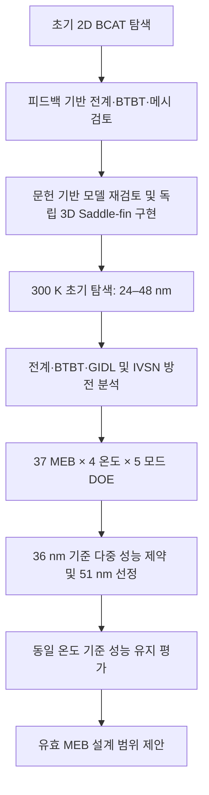
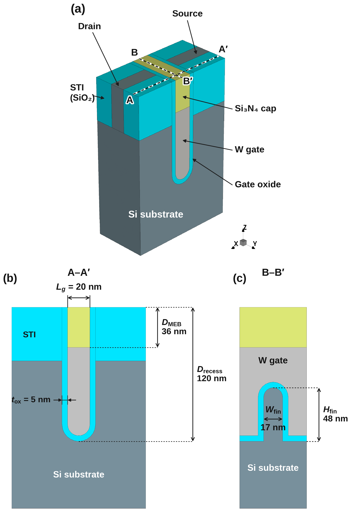
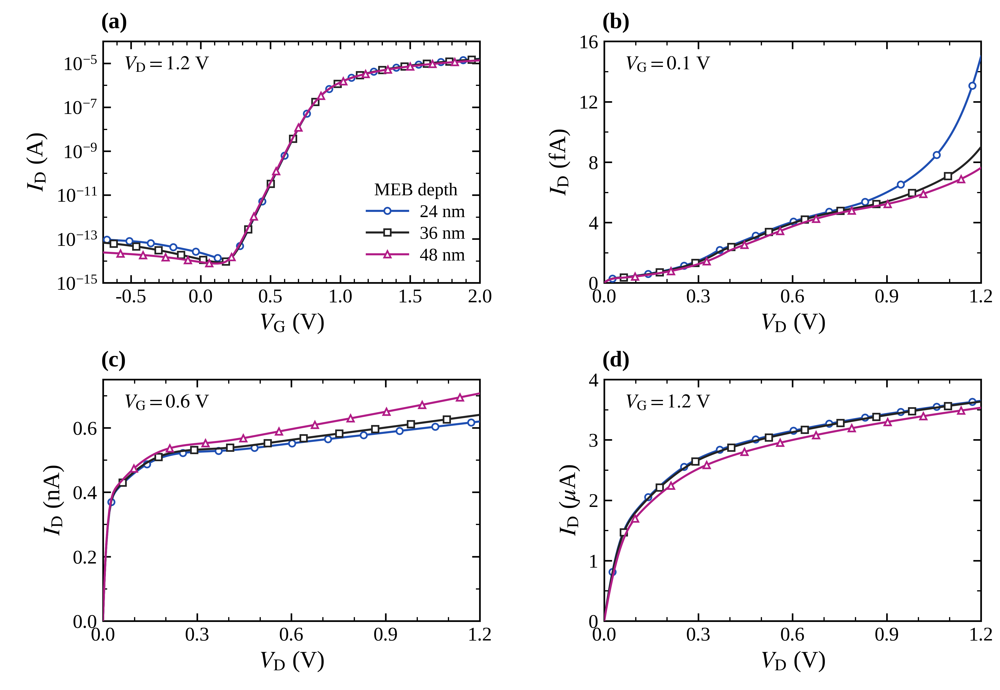
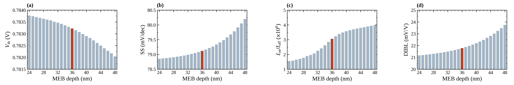
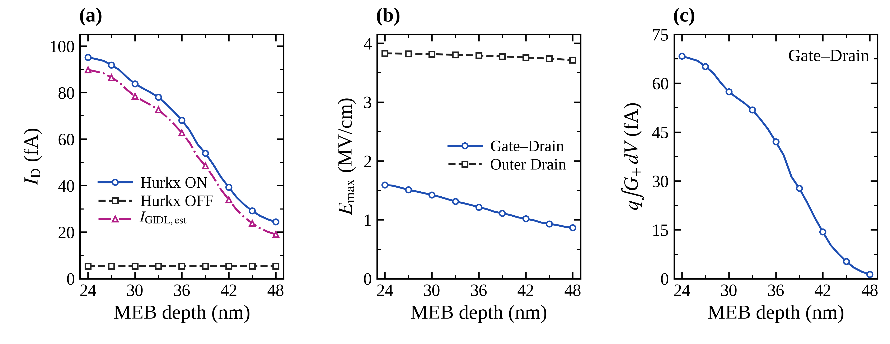
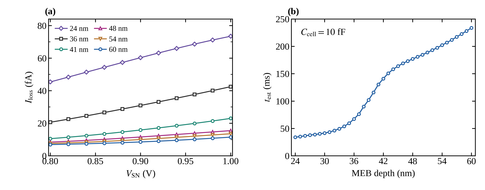
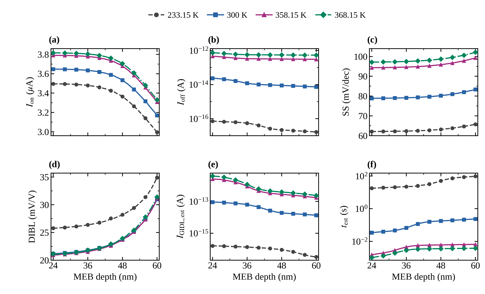
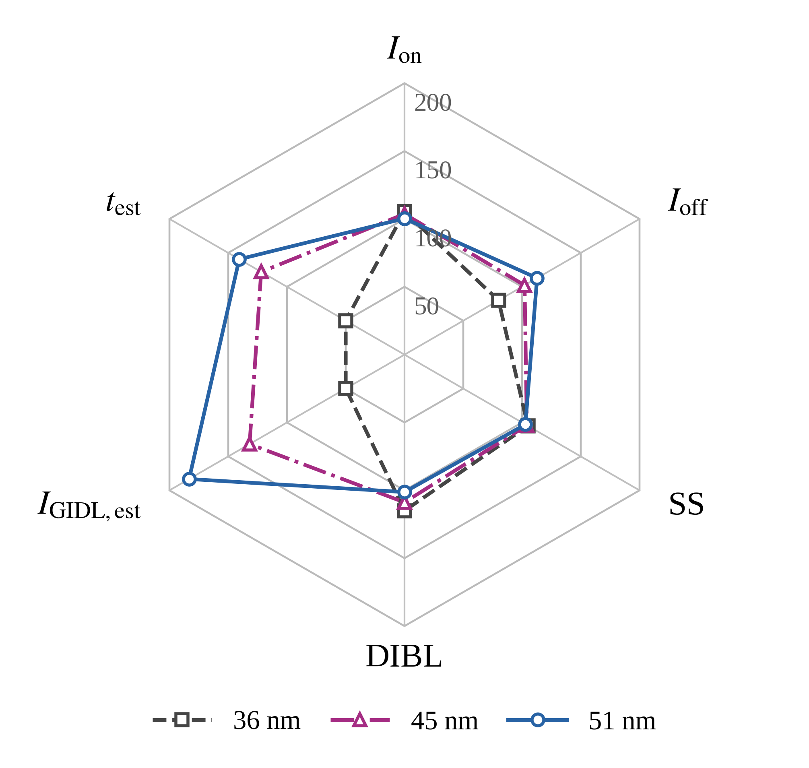
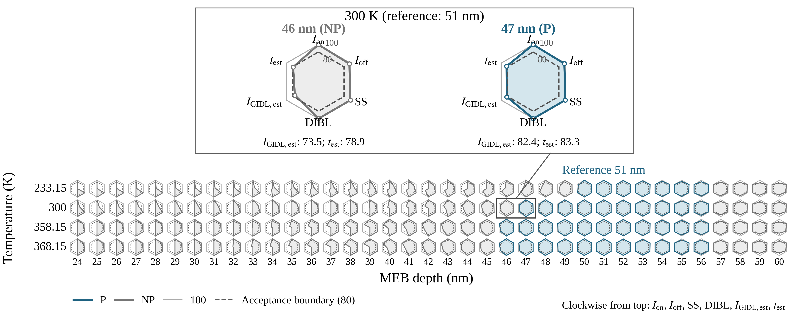
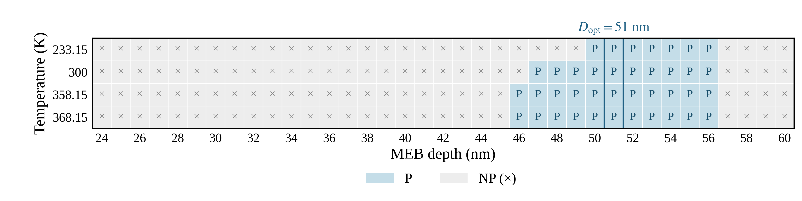

# Chips Master Program (CMP)

**GIDL–Retention Characteristics and Temperature-Dependent MEB Depth Design Window in 20-nm-Class Saddle-Fin BCAT DRAM**

20 nm급 단일 일함수 saddle-fin BCAT에서 금속 게이트 매립 깊이(Metal Etch-Back depth, MEB)에 따른 전기적 특성을 분석하고, GIDL 관련 누설 억제와 저장 노드 방전 특성 개선을 목표로 **DC 성능 제약 기반 최적 MEB 깊이 및 온도 의존적 유효 설계 범위**를 도출한 TCAD 연구입니다.

| Item | Description |
|---|---|
| Program | Chips Master Program (CMP) · 숭실대학교 차세대반도체학과 / 첨단분야 혁신융합대학사업단 |
| Researcher | 송민호 (Minho Song) · 숭실대학교 신소재공학과 |
| Track | AI 반도체 소자·공정 설계 |
| Environment | Synopsys Sentaurus TCAD T-2022.03 · Python |
| Final model | `3D-Sun-SADDLE-V1 / Flat upper S/D` · single-WF W gate |
| Research status | 최종 DOE 데이터 확보, 설계 범위 분석 및 영문 최종 원고 작성 완료 (모델·평가기준 내 결과) |

## Research Navigation

| 자료 | 바로가기 |
|---|---|
| 최종 연구보고서 | [Manuscript & References](docs/manuscript/README.md) |
| TCAD 실행 코드 및 파라미터 | [CMD Hub](CMD_HUB.md) · [SDE](code/sde/3d_sun_saddle_v1/CMP_3D_MEB_DOE_ORIGINAL_dvs.cmd) · [SDevice](code/sdevice/3d_sun_saddle_v1/CMP_3D_MEB_DOE_ORIGINAL_des.cmd) |
| 발표 및 피드백 | [Presentation Archive](docs/presentations/README.md) · [Feedback Log](docs/FEEDBACK_LOG.md) |
| 연구 변천 및 인수인계 | [Project Timeline](PROJECT_TIMELINE.md) · [Handoff](HANDOFF.md) · [Final Analysis](docs/research/final_manuscript_design_window_20261125.md) |
| 최종 데이터 및 검증 근거 | [148-condition Dataset](data/3d_meb_jedec_37depth_complete_20261123/README.md) · [Evidence](docs/evidence/) |

<b>Research Archive — 전체 작업 기록 및 자료 탐색</b>

| 분류 | 저장소 자료 |
|---|---|
| 실행 및 작업 관리 | [Run Sheet](docs/RUN_SHEET.md) · [Task Hub](docs/TASK_HUB.md) · [Code](code/) |
| 연구 의사결정 | [Decisions](docs/DECISIONS.md) · [Research Notes](docs/research/) |
| 검증 및 진행 기록 | [Evidence](docs/evidence/) · [Progress](docs/progress/) · [Validation](docs/validation/) |
| 문헌 및 방법론 | [References](docs/REFERENCES.md) · [Literature](docs/literature/) · [Methodology](docs/methodology/) |
| 데이터 및 이미지 | [Data Archive](data/) · [Historical Images](assets/images/) · [Final Figures](assets/manuscript_figures/) |
| 과거 모델 및 운영 문서 | [Legacy README](README_LEGACY_ARCHIVE.md) · [Previous README (2026-10-08)](README_20261008_ARCHIVE.md) · [Model Scope](docs/MODEL_SCOPE.md) · [Claim–Evidence Matrix](docs/research/CLAIM_EVIDENCE_MATRIX.md) · [Agent Instructions](AGENTS.md) |

기존 2D 및 초기 3D 연구 결과는 해당 모델 계열의 기록으로 보존합니다. 현재 README의 정량적 결론에는 최종 3D 모델 계열의 데이터만 사용합니다. 발표 아카이브에는 현재 확보된 자료와 인덱스가 연결되어 있으며, 미등록 원본은 추후 별도로 보강할 수 있습니다.

## Key Research Results

300 K에서 36 nm 기준 구조와 최종 선정한 51 nm 구조를 비교한 결과입니다.

| Metric | 36 nm (nominal) | 51 nm (selected) | 변화 |
|---|---:|---:|---:|
| On-current, Ion | 3.634 µA | 3.464 µA | **−4.68%** (95.32% 유지) |
| Off-current, Ioff | 11.88 fA | 8.43 fA | **−29.09%** |
| Subthreshold swing, SS | 79.12 mV/dec | 80.75 mV/dec | +2.06% |
| DIBL | 21.79 mV/V | 24.74 mV/V | +13.56% |
| Estimated GIDL current | 62.73 fA | 17.11 fA | **−72.72%** |
| Estimated discharge time, test | 67.16 ms | 188.86 ms | **2.81×** |

**51 nm**는 300 K의 36 nm 기준 구조 대비 여섯 설계 제약을 모두 만족하는 깊이 중 방전시간 추정치가 최대인 지점입니다. 각 온도의 51 nm를 별도 기준으로 평가하면 300, 358.15, 368.15 K에서 공통 상대 성능 유지 범위는 **47–56 nm**이며, 초기 300 K 설계 제약까지 적용하면 **47–51 nm**입니다. 저온을 포함한 결과는 수치적 불확실성을 고려해 잠정 범위로 구분합니다.

---

## 1. 연구 배경 및 문제 정의

DRAM의 셀 면적이 감소함에 따라 접근 트랜지스터의 구동전류를 확보하는 동시에 단채널 효과와 오프 상태 누설을 억제하는 것이 중요해집니다. BCAT는 게이트를 실리콘 표면 아래에 매립한 구조이며, saddle-fin 형상은 실리콘 핀의 상부와 측면을 통해 채널을 제어합니다.

보존 바이어스에서 낮은 게이트 전압과 높은 드레인 전압이 인가되면 드레인 측 전계에 의해 band-to-band tunneling(BTBT)이 발생하여 gate-induced drain leakage(GIDL)가 증가할 수 있습니다. MEB를 증가시키면 금속 게이트 상단의 위치가 깊어져 전계 분포를 조절할 수 있지만, 구동전류와 단채널 특성에 불리한 변화도 발생할 수 있습니다. 또한 특정 바이어스에서의 GIDL 감소만으로 저장 노드의 방전 특성을 판단하기는 어렵습니다.

본 연구에서는 다음 질문을 중심으로 분석을 수행했습니다.

1. MEB 깊이에 따라 DC 성능과 GIDL 관련 누설은 어떻게 변화하는가?
2. 누설 감소는 Gate–Drain 영역의 전계 및 BTBT 생성 변화와 어떤 관련이 있는가?
3. GIDL 감소와 저장 노드 방전시간 개선은 온도에 따라 어떻게 달라지는가?
4. DC 성능의 열화를 제한하면서 누설 억제 효과를 유지할 수 있는 MEB 깊이는 어디인가?

Sun et al.의 BCAT 구조 변수 연구와 Jang and Kim의 이중 일함수 식각 깊이 연구를 참고하되, 단일 일함수 3D saddle-fin BCAT에서 MEB를 독립적으로 변화시키고 전압 의존적 방전 특성 및 온도별 다중 지표를 함께 평가하는 데 초점을 두었습니다.

## 2. 연구 흐름 및 모델 발전

초기에는 2D BCAT 모델을 이용하여 MEB 변화와 누설전류의 관계, 메시 및 공간 전계 분석 방법을 검토했습니다. 발표 피드백을 바탕으로 문헌 구조와 전기적 특성을 재검토하고, 최종적으로 평탄한 상부 S/D와 곡면 saddle-fin을 갖는 독립적인 3D 구조를 구현했습니다. 초기 300 K 분석에서 48 nm까지 누설 억제 효과가 지속되어 탐색 상한을 60 nm로 확장했습니다.

이전 모델의 수치와 최종 3D 모델의 수치를 직접 혼합하지 않고, 연구 방법의 발전 과정만 연결했습니다.

Research records: <a href="PROJECT_TIMELINE.md">Model-lineage history</a> · <a href="docs/FEEDBACK_LOG.md">Feedback responses</a> · <a href="docs/research/mentor_feedback_20261116_final_design_methodology.md">Final design methodology proposal</a>

## 3. 3D 기준 소자 구현 및 해석 조건

  

Fig. 1. 36 nm MEB 기준 BCAT의 3D 구조와 A–A′ / B–B′ 단면.

MEB 깊이는 실리콘 표면(Z = 0)에서 텅스텐 게이트 상단까지의 수직 거리로 정의했습니다. 소자 구조 및 명목 치수는 Sun et al.을 참고하였으며, 전기적 특성까지 정량적으로 보정된 재현 소자는 아닙니다. MEB 이외의 구조와 도핑 조건을 고정해 깊이에 따른 상대 성능 변화를 분석했습니다.

| Parameter | Value |
|---|---:|
| Gate length / recess depth | 20 / 120 nm |
| Nominal MEB depth | 36 nm |
| Gate oxide thickness | 5 nm |
| Fin width / height | 17 / 48 nm |
| Nominal junction / STI depth | 48 / 48 nm |
| Body doping (B) | 1 × 10¹⁷ cm⁻³ |
| Peak S/D doping (As) | 1 × 10²⁰ cm⁻³ |
| Gate work function | 4.8 eV |

SDE를 이용하여 3D 형상, Gaussian S/D 도핑, 접촉면 및 국소 메시 세분화를 구현했습니다. SDevice에서는 Fermi–Dirac 통계, PhuMob, Lombardi 수직 전계 이동도, 준페르미 퍼텐셜 기울기 기반 고전계 포화 및 Hurkx BTBT 모델을 적용했습니다. SRH 생성·재결합과 불완전 이온화는 포함하지 않았으며, 동일한 메시 refinement policy를 적용했지만 메시 수렴성까지 입증한 것은 아닙니다.

실행 코드: [SDE original](code/sde/3d_sun_saddle_v1/CMP_3D_MEB_DOE_ORIGINAL_dvs.cmd) · [SDevice original](code/sdevice/3d_sun_saddle_v1/CMP_3D_MEB_DOE_ORIGINAL_des.cmd) · [Code provenance](docs/progress/3d_meb_jedec_original_nonr1_executed_code_20261123.md)

## 4. MEB 깊이에 따른 DC 특성 분석

  

Fig. 2. 300 K에서 MEB 24, 36, 48 nm 구조의 전달 및 출력 특성.

  

Fig. 3. MEB 24–48 nm의 DC 추출 지표. 적색 막대는 36 nm 기준 구조.

300 K에서 MEB 24–48 nm를 1 nm 간격으로 변화시키고 저·고전압 전달 특성, 세 가지 게이트 바이어스의 출력 특성 및 Hurkx ON/OFF 누설을 분석했습니다. MEB가 24 nm에서 48 nm로 증가함에 따라 온전류는 3.14% 감소했으나 오프전류는 62.1% 감소해 Ion/Ioff가 1.56 × 10⁸에서 3.99 × 10⁸로 증가했습니다. 반면 SS 및 DIBL은 증가했습니다.

| Metric (300 K) | 24 nm | 48 nm |
|---|---:|---:|
| Vth (VD = 1.2 V) | 0.78377 V | 0.78204 V |
| Ion | 3.647 µA | 3.533 µA |
| Ioff | 23.36 fA | 8.86 fA |
| SS | 78.85 mV/dec | 80.20 mV/dec |
| DIBL | 21.17 mV/V | 23.76 mV/V |

이 결과는 깊은 MEB에서 누설 감소와 구동·게이트 제어 성능 열화가 동시에 발생함을 보여주며, 단일 지표가 아닌 복합적인 성능 평가가 필요하다는 근거가 됩니다.

Data: <a href="data/3d_meb_all25_full_extract_20261031/README.md">Initial 25-depth / 175-case archive</a>

## 5. 전계·BTBT·GIDL 물리적 분석

  

Fig. 4. 300 K, VG = −0.7 V, VD = 1.2 V에서의 누설 및 공간 분석.

GIDL 관련 누설을 정량적으로 비교하기 위해 동일 바이어스에서 Hurkx BTBT 모델을 활성화한 드레인 전류와 비활성화한 드레인 전류의 부호 있는 차를 사용했습니다.

$$I_{\mathrm{GIDL,est}}=I_{\mathrm{D,ON}}-I_{\mathrm{D,OFF}}$$

MEB 24–48 nm에서 Hurkx OFF 전류는 5.34–5.37 fA 범위로 거의 일정했습니다. 드레인 측 실리콘을 X 방향의 Gate–Drain(15–30 nm), Mid Drain(30–45 nm), Outer Drain(45–60 nm) 영역으로 구분하여 전계 및 BTBT 생성량을 비교했습니다.

| 분석 지표 | 24 nm | 48 nm | 변화 |
|---|---:|---:|---:|
| Gate–Drain 최대 전계 | 1.593 MV/cm | 0.865 MV/cm | −45.7% |
| Gate–Drain 양의 BTBT 생성량 (q∫G₊dV) | 68.32 fA | 1.31 fA | −98.1% |
| GIDL 추정 전류 | 89.80 fA | 19.04 fA | −78.8% |

Gate–Drain 영역의 전계 완화와 BTBT 생성 억제는 GIDL 관련 단자 전류 감소와 함께 나타났습니다. 다만 지역별 생성량의 전류 환산값은 실제 단자에서 수집된 전류와 동일하지 않으며, Outer Drain 경계의 높은 전계와 생성량이 단자 전류에 기여하는 비율은 분리 검증하지 않았습니다. 따라서 GIDL 추정 전류는 순수 GIDL 분리 측정값이 아니라 BTBT 모델 활성화에 민감한 단자 전류 지표입니다.

Data: <a href="data/3d_meb_all25_full_extract_20261031/SPATIAL/">Spatial field and BTBT analysis</a>

## 6. 1T1C 저장 노드 방전 특성 분석

  

Fig. 5. 300 K에서 대표 MEB별 I–VSN 방전전류와 전체 깊이의 방전시간 추정치.

GIDL 단일 바이어스 결과를 보완하기 위해 MixedMode에서 접근 트랜지스터의 drain/source/gate를 SN/BL/WL에 연결했습니다. 보존 바이어스는 VWL = −0.7 V, VBL = 0 V, substrate = 0 V이며, 셀 커패시턴스는 10 fF로 가정했습니다. 강제 전압원을 이용한 quasistationary sweep으로 VSN = 0.8–1.0 V 구간의 101개 전압점에서 `i(cell,sn)`을 추출했습니다. 유출 전류는 Iloss = −i(cell,sn)으로 정의합니다.

$$t_{\mathrm{est}}=\int_{0.8\,\mathrm V}^{1.0\,\mathrm V}\frac{C_{\mathrm{cell}}}{I_{\mathrm{loss}}(V_{\mathrm{SN}})}\,dV_{\mathrm{SN}}$$

전압 의존적 전류를 사다리꼴 적분한 결과, 300 K의 방전시간 추정치는 MEB 24 nm에서 34.00 ms, 36 nm에서 67.16 ms, 60 nm에서 233.84 ms로 증가했습니다. 이 값은 가정한 커패시턴스 및 모델 내의 비교 지표이며 실제 transient hold/read-failure retention time이 아닙니다. 별도 바이어스에서 얻은 Ioff와 GIDL 추정 전류를 방전전류에 중복 합산하지 않았습니다.

Data: <a href="data/3d_meb_jedec_37depth_complete_20261123/README.md">IVSN and six-metric master</a>

## 7. MEB–Temperature DOE 및 성능 절충 관계

| Variable | Conditions |
|---|---|
| MEB depth | 24–60 nm (1 nm step, 37 depths) |
| Temperature | 233.15, 300, 358.15, 368.15 K |
| MEB × temperature | 148 combinations |
| RunModes | 0, 1, 5, 6, 7 |
| SDevice endpoints | 740/740 numerical endpoints complete |
| Extracted metrics | Ion, Ioff, SS, DIBL, IGIDL,est, test |

온도 조건은 DDR4 SDRAM 데이터시트의 케이스 온도 및 refresh 경계를 참고하여 선정했습니다. 이는 격자 온도의 선정 근거이며 제품 동작 규격의 검증이 아닙니다. 19개 초기 미수렴 해석은 물리 모델을 변경하지 않는 수치해석 복구 조건(R1)으로 완료했습니다.

  

Fig. 6. 네 온도에서 MEB 깊이에 따른 여섯 성능지표 변화.

네 온도에서 MEB가 증가할수록 Ion은 감소하고 SS 및 DIBL은 악화되는 경향을 보였습니다. 동일 온도의 36 nm 구조 대비 51 nm의 GIDL 추정 전류 감소 효과는 고온에서도 약 70%를 유지했지만, 오프전류 감소율과 방전시간 개선 배율은 낮아졌습니다.

| Temperature | GIDL 추정 전류 감소 | 방전시간 개선 배율 | 51 nm의 test |
|---|---:|---:|---:|
| 300 K | 72.72% | 2.81× | 188.86 ms |
| 358.15 K | 71.43% | 1.38× | 6.17 ms |
| 368.15 K | 69.82% | 1.27× | 3.61 ms |

이 결과는 GIDL 억제 효과가 고온의 절대 보존 특성 개선을 동일한 비율로 보장하지 않음을 보여줍니다. 따라서 온도별 DC 특성과 누설 특성뿐 아니라 전압 의존적 방전시간 추정치를 독립적인 지표로 고려했습니다.

Data: <a href="data/3d_meb_jedec_37depth_complete_20261123/six_metrics_148_conditions.csv">148-condition CSV</a> · <a href="data/3d_meb_jedec_37depth_complete_20261123/node_qc_740.csv">740-node QC</a> · <a href="data/3d_meb_jedec_37depth_complete_20261123/SOURCE_MANIFEST.md">Source manifest</a>

## 8. 성능 제약조건 및 최적 MEB 선정

### 8.1 평가 기준

최적 깊이 선정과 선정 깊이 주변의 성능 유지 여부를 별개의 문제로 정의했습니다. 첫 단계에서는 300 K의 36 nm 구조를 기준으로 여섯 지표의 설계 제약을 적용하고, 두 번째 단계에서는 선정된 51 nm 구조의 **각 온도에서의 성능**을 기준으로 상대 열화를 평가했습니다.

| Metric | 초기 설계 제약 (36 nm, 300 K 기준) | 상대 성능 유지 (51 nm, 동일 온도 기준) |
|---|---:|---:|
| Ion | ≥95% | ≥95% |
| Ioff | ≤80% | ≤150% |
| SS | ≤105% | ≤105% |
| DIBL | ≤115% | ≤115% |
| IGIDL,est | ≤50% | ≤120% |
| test | ≥200% | ≥90% |

초기 제약은 구동전류 유지, 단채널 특성 열화 제한과 함께 GIDL 추정 전류의 최소 50% 감소 및 방전시간의 두 배 이상 증가를 요구합니다. 상대 평가에서는 DC 성능 유지와 함께 보존 관련 핵심 지표인 GIDL 및 방전시간의 열화를 제한했습니다. 이는 선행연구의 절충 설계 접근을 참고하여 본 연구에서 정의한 공학적 조건이며, 표준 제품 합격 기준은 아닙니다.

### 8.2 균등가중 후보와 제약 기반 최적점

  

Fig. 7. 300 K, 36/45/51 nm 비교. 각 초기 설계 제약의 허용 경계를 100점으로 설정한 정규화 결과.

300 K에서 여섯 지표를 min–max 정규화하고 동일 가중치로 평균한 결과, 45 nm가 최고점인 80.82점을 얻었습니다. 다만 본 연구는 여섯 지표를 균등하게 최대화하는 것보다 DC 성능 제약을 만족하면서 방전시간을 개선하는 것을 목표로 하므로 별도의 제약 기반 최적화를 수행했습니다.

| Metric | 36 nm | 45 nm | 51 nm |
|---|---:|---:|---:|
| Ion (µA) | 3.634 | 3.579 | 3.464 |
| Ioff (fA) | 11.88 | 9.30 | 8.43 |
| SS (mV/dec) | 79.12 | 79.78 | 80.75 |
| DIBL (mV/V) | 21.79 | 23.02 | 24.74 |
| IGIDL,est (fA) | 62.73 | 23.80 | 17.11 |
| test (ms) | 67.16 | 163.83 | 188.86 |

초기 여섯 조건을 만족하는 깊이는 44–51 nm였으며 그중 test가 가장 큰 51 nm를 선정했습니다. 43 nm는 Ioff 상한을 초과하고, 52 nm는 Ion 하한 및 DIBL 상한을 위반합니다. 51 nm는 45 nm에 비해 온전류가 3.20% 감소하지만 GIDL 추정 전류가 28.09% 감소하고 방전시간이 15.28% 증가합니다.

Fig. 7의 점수는 초기 제약의 경계를 100점으로 둔 비율이며, 45 nm 선정에 사용한 min–max 점수와 동일한 정의가 아닙니다.

### 8.3 평가기준 민감도

| 초기 설계 제약의 변경 | 최적 MEB |
|---|---:|
| 기존 조건 | 51 nm |
| Ion ≥96% / ≥97% / ≥98% | 50 / 48 / 46 nm |
| DIBL ≤110% | 48 nm |
| Ioff ≤70% | 충족 구조 없음 |
| Ion ≥94%, DIBL ≤120% | 52 nm |

51 nm는 탐색한 구조 및 설정한 제약에 따른 최적점입니다. 구동전류와 DIBL 제약에 따라 선정 깊이가 달라지므로 절대적인 공정 최적값으로 해석하지 않습니다.

## 9. 온도 의존적 유효 MEB 설계 범위 제안

### 9.1 동일 온도 상대 성능 평가

  

Fig. 8. 각 온도의 51 nm를 기준으로 한 148개 조건의 육각형 성능 평가. 확대도는 300 K의 46 nm와 47 nm 판정 전환.

각 온도의 기준값 Ri와 평가값 Mi를 비교하고, 개선 방향에 따라 열화율 Li를 정의했습니다. 허용 열화율 Ai를 이용해 모든 지표의 허용 경계가 80점이 되도록 정규화했습니다.

$$L_i=\begin{cases}\max(0,1-M_i/R_i),&\text{larger is better}\\\max(0,M_i/R_i-1),&\text{smaller is better}\end{cases}$$

$$S_i=\operatorname{clip}(100-20L_i/A_i,\ 0,\ 100)$$

기준 이상의 성능은 100점, 허용 열화 경계는 80점입니다. 모든 지표가 허용 조건을 충족하면 P(Pass), 하나라도 위반하면 NP(Non-pass)로 분류했습니다. 300 K에서 46 nm의 GIDL 및 방전시간 점수는 73.5점, 78.9점이지만 47 nm에서는 82.4점, 83.3점으로 증가해 두 지표 모두 경계를 통과합니다.

### 9.2 최종 MEB Design Window

  

Fig. 9. 37개 깊이 × 4개 온도의 P/NP Map. 233.15 K 결과는 아래의 저온 수치적 불확실성을 함께 고려해야 합니다.

| Temperature | 상대 성능 유지 범위 |
|---|---:|
| 233.15 K | 50–56 nm (잠정) |
| 300 K | 47–56 nm |
| 358.15 K | 46–56 nm |
| 368.15 K | 46–56 nm |
| **상온·고온 3조건 공통** | **47–56 nm** |
| 네 온도 공통 | 50–56 nm (잠정) |

얕은 깊이의 경계는 GIDL 추정 전류 및 방전시간 제약에 민감하고, 깊은 깊이의 경계는 온전류 유지 조건에 의해 결정됩니다. 동일 온도 기준 평가에서 온전류 하한을 96%로 강화하면 상온·고온 공통 범위는 47–55 nm로, GIDL 상한을 110% 또는 방전시간 하한을 95%로 강화하면 각각 49–56 nm로 변화합니다.

| 최종 제안 범위 | 동일 온도 상대 성능 유지 | 초기 300 K 설계 제약까지 만족 |
|---|---:|---:|
| 300 / 358.15 / 368.15 K | **47–56 nm** | **47–51 nm** |
| 233.15 K 포함 네 온도 | 50–56 nm (잠정) | 50–51 nm (잠정) |

예를 들어 56 nm 구조는 동일 온도의 51 nm 대비 상대 조건을 만족하지만, 300 K의 36 nm 대비 Ion은 91.22%로 초기 하한인 95%에 미달합니다. 따라서 두 범위는 목적이 다른 설계 기준의 결과이며 구분하여 제안합니다.

저온에서는 36–60 nm의 25개 구조에서 저장 노드 전류 수지의 최대 상대 잔차가 수치 검사 한계인 1%를 초과했습니다(전체 최대 15.57%, 57 nm). 방전시간 추정에 미치는 영향이 정량화되지 않았으므로 저온을 포함하는 범위는 잠정 결과입니다. P/NP는 시뮬레이션을 수행한 네 온도에서의 수치상 판정이며 연속 온도 구간의 보증이나 절대 retention 규격을 의미하지 않습니다.

## 10. 연구 결론 및 후속 검증

본 연구에서는 단일 일함수 3D saddle-fin BCAT에서 MEB 깊이가 증가할 때 Gate–Drain 영역의 전계와 BTBT 생성량이 감소하고, GIDL 추정 전류 감소 및 저장 노드 방전시간 증가가 나타나는 것을 확인했습니다. 전체 148개 구조–온도 조합에 대한 성능 분석과 제약 기반 평가를 통해 51 nm를 300 K의 최적 깊이로 선정하고, 동일 온도 상대 성능을 유지하는 공통 설계 범위를 제안했습니다.

MEB는 구동전류 손실을 제한하면서 누설 억제와 보존 관련 특성을 개선할 수 있는 구조적 설계 변수입니다. 다만 본 연구는 실제 식각 공정의 재현, 양산 공정 변동의 허용오차 또는 제품 수준의 retention/refresh 성능 검증을 수행한 것은 아닙니다. 후속 검증 과제로는 실제 transient hold/read-failure 평가, SRH 및 결함 관련 누설 모델, 메시 수렴성 및 저온 전류 수지의 수치적 불확실성 분석이 남아 있습니다.

## Reproducibility & References

최종 DOE의 740개 수치해석 조건과 148개 지표 조합을 확인할 수 있는 [데이터 아카이브](data/3d_meb_jedec_37depth_complete_20261123/README.md), 실제 실행 [코드 허브](CMD_HUB.md), [독립 분석에 사용되는 원본 CSV](data/3d_meb_jedec_37depth_complete_20261123/six_metrics_148_conditions.csv)를 제공합니다. 원본 네이티브 TDR/PLT 및 전체 로그는 저장소 외부에 보존되어 있으며, GitHub에는 내보낸 수치 데이터 및 출처·해시 기록이 포함되어 있습니다.

주요 선행연구 및 모델 근거:

- Lee et al., *Partial Isolation Type Buried Channel Array Transistor (Pi-BCAT) for a Sub-20 nm DRAM Cell Transistor*, Electronics, 2020. [DOI](https://doi.org/10.3390/electronics9111908)
- Sun et al., *Simulation Study: The Impact of Structural Variations on the Characteristics of a Buried-Channel-Array Transistor (BCAT) in DRAM*, Micromachines, 2022. [DOI](https://doi.org/10.3390/mi13091476)
- Jang and Kim, *Impact of Metal and Poly Gate Thickness on GIDL in DRAM Dual Work-Function Structures*, ICEIC, 2026. [DOI](https://doi.org/10.1109/ICEIC69189.2026.11386251)
- Hurkx et al., *A new recombination model for device simulation including tunneling*, IEEE Transactions on Electron Devices, 1992. [DOI](https://doi.org/10.1109/16.121690)

전체 참고문헌과 논문 구성은 [Manuscript & References](docs/manuscript/README.md), 기존 문헌 분석 및 연구 이력은 [References Hub](docs/REFERENCES.md)에서 확인할 수 있습니다.
