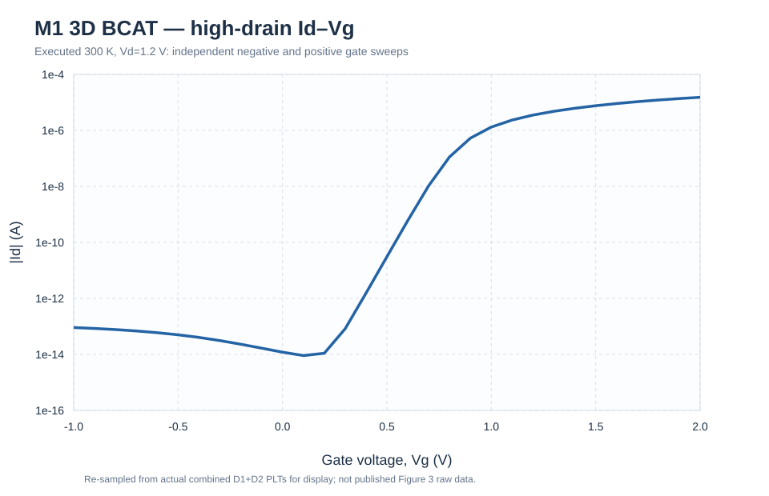
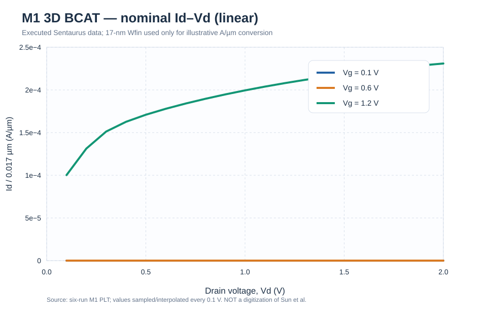
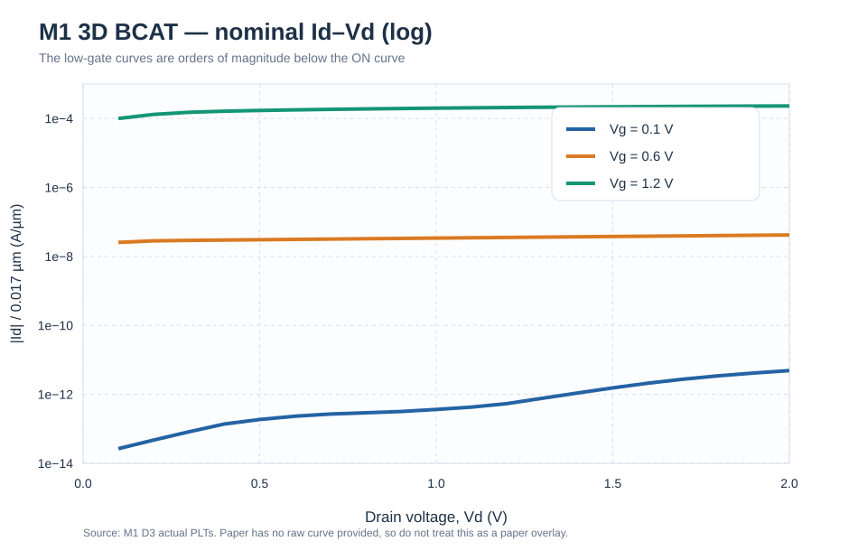

# 3D BCAT nominal DC verification — Sun-SADDLE-V1 / M1 (2026-10-17)

**State: 6/6 numerical sweeps passed, but physical/paper reproduction PROVISIONAL.** Independent structural reconstruction, **not** the historical `3D-Sun-B0` nor the frozen `B0-2D-PAPER-CAL`. No full parameter sweep, no retention proof, no new freeze.

**Original paper:** [Sun, Baac & Shin (2022), Micromachines 13, 1476](https://doi.org/10.3390/mi13091476). The paper's **Table 1** contains Id–Vg and Id–Vd for five structural variables and reports drain current in **A/µm**; **Figure 3** and text give the nominal Vth/SS/Ion/Ioff/DIBL. The *paper's underlying trace data have not been obtained or systematically digitized*, so the following figures contain **CMP-executed curves only**, not invented paper overlays.

## Geometry and lineage
- Explicit lower Si saddle/rounded crest and separate W visualization body. W is removed and used as the gate boundary contact for the electrical mesh; the structure-only W screenshot/TDR is not fed to SDevice.
- SWB inputs held nominal: `ARgate=6.0, DBCAT_nm=36, JunctionRatio=0.4, Wfin_nm=17, RfilletFactor=1.0`. Temperature **300 K**, WF **4.8 eV**, PhuMob + Lombardi + high-field saturation + Hurkx.
- **M0 FAST**: 259,919 SVisual elements, 39,989 points; successful quick Vd=0.05 IdVg; historical combined negative-gate high-Vd continuation failed. **M1** local Si saddle refinement: 538,096 elements, 84,537 points; all six present DC runs successful. Because D1/D2 separate sweep directions as well, do not attribute the improved convergence solely to mesh changes.
- Six SDE `n1_msh.tdr` hashes identical SHA256 `f045dd9e52e8105620ea5dbc79ccb048f58c7f85b5d067662ef07164222f1283`.
- **M1 mesh-quality unresolved:** minimum edge `8.350923e-7 µm` (=0.000835 nm), worst R/H `3.230205e8`; 189 non-Delaunay tetrahedra of 486,701 SDevice tetrahedra (0.04%). A numerical sweep completing does not establish field/BTBT or electrical mesh convergence.

## Complete six-sweep source QC

| Run | Actual SWB project | Bias | Outcome |
|---|---|---|---|
| D0 | `B0_3D` | Vd=0.05, Vg=0→1.5 V | **PASS**, 60 transfer points |
| D1 | `B0_3D_Copy` | Vd=1.2, Vg=0→2 V | **PASS**, 107 transfer points |
| D2 | `B0_3D_Copy_Copy` | Vd=1.2, Vg=0→−1 V | **PASS**, 205 transfer points |
| D3-1 | `B0_3D_D3_1` | Vg=0.1, Vd=0→2 V | **PASS**, 107 output points |
| D3-2 | `B0_3D_D3_2` | Vg=0.6, Vd=0→2 V | **PASS**, 108 output points |
| D3-3 | `B0_3D_D3_3` | Vg=1.2, Vd=0→2 V | **PASS**, 109 output points |

D3 endpoint currents: **8.3194×10⁻¹⁴ / 7.1302×10⁻¹⁰ / 3.9264×10⁻⁶ A** in ascending Vg. Source-to-drain current accounts for **0.278% / 99.999% / nearly 100%** of those drain totals; at Vg=0.1 V drain current is largely balanced by the **body**, so it cannot be called pure channel current or all-GIDL. Three D3 target voltages reached and all simulations return license successfully. D3 PLT vs D1 IdVg at Vd=1.2 V: **+0.879%, ~0%, ~0%** at Vg=0.1/0.6/1.2 V.

## Paper-style curves: native simulation, not paper digitization

**Critical normalization:** the Id–Vd figures divide the **3D total current** by the **nominal geometric Wfin=0.017 µm** as an *illustration*; this is not a demonstrated paper-equivalent effective channel width. Paper Table 1 shows substantial current for its lower Vg output curves; our Vg 0.1/0.6 V traces remain many orders lower on the same reported A/µm scale. The Vg=1.2 V endpoint is approximately `2.31e-4 A/µm`, near the plotted current scale of the paper's high-gate line, but an exact trace-to-trace residual is **not claimed** without paper digitization and width matching.

## Nominal metrics compared with **published** values

| Metric | Sun 2022 nominal | CMP M1 | Difference and definition |
|---|---:|---:|---|
| Vth | 0.656 V | **0.786046 V** | +0.130046 V; assumed `Icrit=1e-7×(17/20)=8.5e-8 A` |
| SS | 76 mV/dec | **77.079 mV/dec** | +1.079; fit log `abs(Id)` in 1e−12→1e−9 A |
| DIBL | 23.6 mV/V | **22.814 mV/V** | −0.786; computed from Vd 0.05/1.2 V |
| Ion/Ioff | 3.4×10¹⁰ | **1.6725×10⁸** | **illustrative only**; Id(Vg=2)/Id(Vg=−1), Vd=1.2 V |

**Do not equate near-paper SS/DIBL to calibrated paper reproduction.** The original paper specifies the constant-current Vth concept but does not fully disclose its numerical SS fitting range, DIBL drain-bias pair, or Ion/Ioff endpoint and effective width convention. The ~0.13 V threshold offset, output curves at low gate voltage, unmatched Ion/Ioff convention, and pathological local mesh remain open research issues. Historical baseline values from other lineages must not be intermixed.

## Artifacts and verifiable provenance
- [Simulation run summary](RUN_STATUS.csv), [nominal-metric comparisons](NOMINAL_BENCHMARK.csv).
- [Sampled M1 D3 output CSV](IDVD_FIGURE_SAMPLED_0p1V.csv), [sampled high-Vd transfer CSV](IDVG_FIGURE_SAMPLED_0p1V.csv). These contain **interpolated/resampled chart points**, not the entire original PLT, and MUST NOT be labelled raw executable output or literature data.
- Raw original source archives uploaded by researcher: `CMP_3D_THREE_PROJECTS_CORE.zip` SHA256 `a32ee3a264c23119592f3d02ee99964685612b158b0f5b098ef8d1ccf164a728`; `CMP_3D_D3_ONLY_CORE.zip` SHA256 `6ad30e5fd126509ecb261ab56cb5469f4352e774140a184b1185007825c53169`. Full 3D TDRs remain **outside GitHub** due size; original archive hashes are recorded in the full local QC package. Do not claim that these lightweight chart samples replace the complete PLTs.
- Executed decks, all original numerical CSVs, logs and full figures are in the companion delivered `CMP_3D_SADDLE_BASELINE_VALIDATION_20261017_PACKAGE.zip`. This repository directory is the curated/public scientific evidence index.

**Next research gate:** reconcile width/metric definitions and low-gate IdVd mismatches; inspect and repair sliver geometry (rather than only increasing element count), compare representative DC and spatial hotspot observables across truly distinct meshes, then decide whether a 5-variable DOE is justified. No README/public headline baseline promotion.
